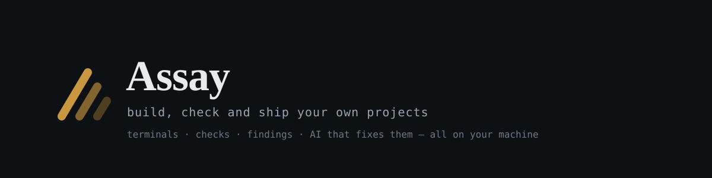

<p align="center">
  
</p>

<p align="center">
  <a href="LICENSE"></a>
  <a href="https://github.com/develoverli/assay-code/actions/workflows/ci.yml"></a>
  <a href="https://github.com/develoverli/assay-code/releases"></a>
  
  
  
</p>

# Assay

A desktop app for taking **your own projects from first line to production in one place**: real
terminals and an editor over the working tree, the **linters, scanners and ethical-pentest tools you
trust**, and **AI agents — local models or cloud ones — that fix what those tools find**.

No server, no account, no telemetry. Everything runs on your machine, over code and targets you own.

> [!WARNING]
> **For your own projects only.** Assay is for testing code and targets you own or are explicitly
> authorized to test. URL scans are gated behind an authorization confirmation. Don't point it at
> anything you don't have permission to assess.

## Features

- **Projects** — local folders and URLs, with the stack detected, tags, and cloning straight from
  your GitHub account.
- **Tools** — linters, scanners and pentest agents run per project, with the exact command shown
  before anything runs. Output streams line by line and is parsed into normalized findings.
- **Findings + AI fix loop** — findings by severity, tagged by tool. Select them, **Fix with AI**,
  **Retest**, and fixed issues move to *solved*. Ignoring or accepting a finding survives the next
  scan. Export as SARIF or Markdown.
- **Workspace** — real terminals (PTYs, so interactive agents like Claude Code run inside), a Monaco
  editor, a file tree with git status, content search, a Git panel (stage, commit, push, pull, pull
  requests) and your past Claude Code sessions.
- **Deploy** — SFTP / FTP / FTPS upload of what changed, with host key pinning, passwords in the OS
  keychain and optional auto-upload. Reads and writes `.vscode/sftp.json`.
- **Audit** — every run is an immutable snapshot with its raw log and per-file diffs.
- **Skills and commands** — reusable AI tasks and project actions, run headless or in a terminal.
- **AI per task** — pick Claude, opencode, Hermes, or a local model (Ollama, LM Studio) for each
  job: fixing, skills, commit messages, improving prompts.
- **Scheduled scans and notifications** — off until you turn them on.

## Built-in tools

| Tool | Scope | What |
|---|---|---|
| [ESLint](https://eslint.org/) | local | JS / TS / React rules, run from Assay's own sandbox with a generated config |
| [Ruff](https://docs.astral.sh/ruff/) | local | Python linting |
| [Semgrep](https://semgrep.dev/) | local | SAST rule packs |
| [Gitleaks](https://github.com/gitleaks/gitleaks) | local | Secrets in the working tree (always redacted) |
| [OSV Scanner](https://google.github.io/osv-scanner/) | local | Known vulnerabilities in dependencies |
| [React Doctor](https://www.react.doctor/) | local | React anti-patterns, performance, a11y |
| [SonarQube](https://www.sonarsource.com/products/sonarqube/) | local | Bugs, code smells, vulnerabilities and hotspots (Community Build in Docker, or your own server) |
| [graphify](https://pypi.org/project/graphifyy/) | local | Knowledge graph of the codebase, for AI agents |
| [Unlighthouse](https://unlighthouse.dev/) | url | Whole-site Lighthouse: Web Vitals and their causes |
| [Strix](https://github.com/usestrix/strix) | url | AI penetration-testing agent (Docker + an LLM key) |

The registry is data-driven: add your own tools and skills from the app. Assay never writes configs,
dependencies or lockfiles into the project it scans.

## Install

Download the installer for your platform from
[Releases](https://github.com/develoverli/assay-code/releases):

- **Windows** — `.exe` (NSIS, per-user, no admin needed)
- **macOS** — universal `.dmg`. Unsigned builds warn on first open: right-click → **Open**.
- **Linux** — `.AppImage` / `.deb`

## Build from source

**Prerequisites**

- [Node.js](https://nodejs.org/) 20.19+ (22 recommended) and [pnpm](https://pnpm.io/) 10
- [Rust](https://www.rust-lang.org/tools/install) stable, plus the
  [Tauri prerequisites](https://v2.tauri.app/start/prerequisites/) for your OS
- Optional: [Docker](https://www.docker.com/) (SonarQube, Strix), and the `claude`, `opencode` or
  `hermes` CLIs for AI

```bash
pnpm install
pnpm tauri dev      # run the app in development
pnpm tauri build    # build an installer for the current platform
```

Checks:

```bash
pnpm typecheck
pnpm test
cargo check --manifest-path src-tauri/Cargo.toml
```

## How it works

1. **Add a project** — a folder, a URL, or a clone from GitHub.
2. **Run a tool** — a per-tool adapter turns its output into normalized findings.
3. **Fix with AI** — the agent gets the findings and edits only the files they point at, under hard
   limits (no suppressions, no dependency or config changes, no destructive commands).
4. **Retest** — fixed issues become *solved*; the previous scan stays as a snapshot.

Architecture notes and the reasoning behind each decision live in [AGENTS.md](AGENTS.md).

## Contributing

Issues and pull requests are welcome. Read [CONTRIBUTING.md](CONTRIBUTING.md) first and follow the
[Code of Conduct](CODE_OF_CONDUCT.md). Security issues go through [SECURITY.md](SECURITY.md), never
public issues.

## License

[GPL-3.0-only](LICENSE) © 2026 develoverli. You may use, study, share and modify Assay. If you
distribute it or a modified version, you must do so under the same license, with its source.
